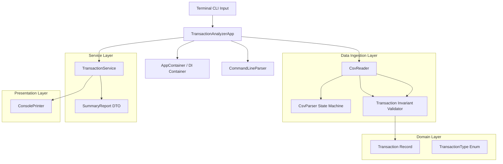

# 📊 Transaction Analyzer CLI

[](https://github.com/yeswadams/java_cli_app/actions/workflows/ci.yml)


A high-performance, enterprise-grade command-line financial analysis application built with **Java 17** and the **Java Standard Library**.

Transaction Analyzer processes structured financial transaction logs from CSV files, performs penny-accurate financial metric computations, enforces strict domain validation invariants, and renders structured reports directly to the terminal. Engineered with zero external application dependencies, the project demonstrates idiomatic object-oriented design, functional stream pipelines, state-machine parsing, defensive programming, and automated cross-platform testing.

---

## 🎯 Engineering & Design Highlights

- **Zero-Dependency Architecture**: Built entirely on core Java 17 standard libraries (`java.nio`, `java.time`, `java.math`, `java.util.stream`). No Spring, Lombok, or third-party parsing dependencies.
- **Exact Decimal Precision**: Eliminates IEEE 754 binary floating-point inaccuracies by strictly utilizing `BigDecimal` with explicit scale enforcement (`RoundingMode.HALF_UP`) for all financial summations and balance checks.
- **RFC 4180-Compliant State Machine**: Custom character-by-character lexical scanner that seamlessly handles escaped quotation marks (`""`), multiline/embedded commas, and trailing whitespace without expensive regular expressions.
- **Fault-Isolated Data Ingestion**: Malformed rows, invalid data types, and non-positive numbers are isolated and logged without terminating the processing pipeline. Duplicate transaction identifiers are detected and dropped gracefully.
- **Domain-Driven Design (DDD) & Java Records**: Domain entities use immutable Java records with defensive compact constructors that validate contract invariants before object instantiation.
- **Clean Architecture & Separation of Concerns**: Discrete architectural layers (CLI presentation, business services, domain models, data ingestion, and Inversion of Control container).
- **Testable Application Entry Point**: Orchestrator separates execution logic (`int run(...)`) from process termination (`System.exit(...)`), enabling end-to-end automated testing of exit status codes and help screens.

---

## 🏛️ System Architecture



### Layer Responsibilities

| Package | Responsibility | Components |
|---|---|---|
| `com.csv.analyzer` | Application bootstrapping & process lifecycle | `TransactionAnalyzerApp`, `TransactionAnalyzer` |
| `com.csv.analyzer.cli` | Presentation layer: argument parsing & terminal formatting | `Command`, `CommandLineParser`, `ConsolePrinter` |
| `com.csv.analyzer.config` | Inversion of Control & dependency injection wiring | `AppContainer` |
| `com.csv.analyzer.csv` | Lexical state machine & streaming CSV file ingestion | `CsvParser`, `CsvReader`, `CsvParseException` |
| `com.csv.analyzer.domain` | Immutable domain models, enums & validation invariants | `Transaction`, `TransactionType` |
| `com.csv.analyzer.service` | Business logic, aggregation, decimal math & query filtering | `TransactionService`, `SummaryReport` |

---

## 🚀 Getting Started

### Prerequisites

- **Java Development Kit (JDK)**: Version 17 or higher (Temurin, OpenJDK, or Oracle).
- **Apache Maven**: Version 3.8+ (or use IntelliJ IDEA's bundled Maven).
- **Terminal / Shell**: PowerShell, Bash, or Zsh.

### Verify Environment

```bash
java -version
mvn -version
```

### Build & Package Standalone JAR

```bash
# Compile and execute the complete automated test suite
mvn clean test

# Build the shaded self-contained executable JAR
mvn package
```

The resulting standalone executable JAR will be located at `target/transaction-analyzer.jar`.

---

## 💻 CLI Usage & Examples

A sample dataset is included in the project root: [`sample_transactions.csv`](sample_transactions.csv).

```bash
java -jar target/transaction-analyzer.jar <command> <file-path> [options]
```

### 1. Financial Summary (`summary`)
Calculates total processed transactions, cumulative income, total expenses, net balance, and highlights peak transactions.

```bash
java -jar target/transaction-analyzer.jar summary sample_transactions.csv
```

**Output:**
```text
    =============== FINANCIAL SUMMARY REPORT ===============

Processed Count : 10 entries
Total Income : 112,500.00
Total Expenses : 34,901.50
Net Account Bal : 77,598.50
Peak Income Record: Salary, January base bonus (85,000.00)
Peak Expense Record: Office Rent Processing (25,000.00)
```

---

### 2. Categorical Aggregation (`categories`)
Aggregates transactional entries grouped by categorical values, displaying net impact per category.

```bash
java -jar target/transaction-analyzer.jar categories sample_transactions.csv
```

**Output:**
```text
====== NET TRACKING BY CATEGORY ===========
 * Salary          : 85,000.00
 * Utilities       : -4,400.50
 * Consulting      : 22,500.00
 * Bonus           : 5,000.00
 * Supplies        : -450.25
 * Housing         : -25,000.00
 * Marketing       : -4,200.00
 * Food            : -850.75
```

---

### 3. Chronological Monthly Tracking (`monthly`)
Renders monthly financial breakdowns using sorted `TreeMap` aggregations.

```bash
java -jar target/transaction-analyzer.jar monthly sample_transactions.csv
```

**Output:**
```text
====== CHRONOLOGICAL MONTHLY LOGS ======
 [2026-01] -> Incoming: 100,000.00 | Spent: 28,200.50
 [2026-02] -> Incoming: 5,000.00 | Spent: 2,050.75
 [2026-03] -> Incoming: 7,500.00 | Spent: 4,650.25
```

---

### 4. Query & Filter (`search`)
Queries and filters transactions with optional constraints (`--type`, `--category`) and prints matching records.

```bash
# Filter by EXPENSE and category Utilities
java -jar target/transaction-analyzer.jar search sample_transactions.csv --type EXPENSE --category Utilities
```

**Output:**
```text
======== MATCHING TRACKED RECORDS =========
TXN-103 | 2026-01-15 | Cloud Infrastructure | EXPENSE | 3,200.50
TXN-106 | 2026-02-14 | Software Licenses    | EXPENSE | 1,200.00
```

---

### 5. Help Guide (`help`)

```bash
java -jar target/transaction-analyzer.jar help
```

---

## 🐳 Running with Docker

The application provides a production-hardened, multi-stage [`Dockerfile`](Dockerfile) that compiles the application in a Maven build container and produces a minimal, secure image based on `eclipse-temurin:17-jre-alpine` running as an unprivileged non-root user.

### 1. Build the Docker Image

```bash
docker build -t transaction-analyzer .
```

### 2. Run CLI Commands with Mounted Data

Mount your current working directory to `/data` inside the container:

```bash
# View help
docker run --rm transaction-analyzer

# Run Financial Summary
docker run --rm -v "${PWD}:/data" transaction-analyzer summary /data/sample_transactions.csv

# Run Categorical Aggregation
docker run --rm -v "${PWD}:/data" transaction-analyzer categories /data/sample_transactions.csv

# Run Monthly Breakdown
docker run --rm -v "${PWD}:/data" transaction-analyzer monthly /data/sample_transactions.csv

# Search & Filter
docker run --rm -v "${PWD}:/data" transaction-analyzer search /data/sample_transactions.csv --type EXPENSE --category Utilities
```

> **Tip for Linux / macOS shells**: Replace `"${PWD}"` with `"$(pwd)"`.

---

## 🧪 Automated Testing Strategy

The test suite contains **41 automated JUnit 5 tests** across unit, edge-case, and integration scenarios:

- **Isolated Temporary Directories**: File I/O tests use JUnit 5 `@TempDir` to provision and automatically clean sandboxed filesystem resources, preventing platform-specific path issues across OS boundaries.
- **State Machine Edge Cases**: Verified against nested commas within quotes, escaped double quotes (`""`), leading/trailing whitespaces, and unclosed quotation marks.
- **Precision Arithmetic**: Asserts decimal accuracy on precision-sensitive numbers (e.g., `0.10 + 0.20 = 0.30`) avoiding binary floating point drift.
- **Fault Tolerance**: Verified that corrupted lines and duplicate IDs trigger warnings without aborting valid rows.
- **Process Exit Testing**: CLI integration tests verify exit codes (0 for valid executions, 1 for errors) without terminating the test runner JVM.

```bash
mvn test
```

```text
[INFO] Running com.csv.analyzer.cli.CommandLineParserTest (9 tests) - OK
[INFO] Running com.csv.analyzer.csv.CsvParserTest (6 tests) - OK
[INFO] Running com.csv.analyzer.csv.CsvReaderTest (5 tests) - OK
[INFO] Running com.csv.analyzer.domain.TransactionTest (11 tests) - OK
[INFO] Running com.csv.analyzer.service.TransactionServiceTest (6 tests) - OK
[INFO] Running com.csv.analyzer.TransactionAnalyzerAppTest (4 tests) - OK
[INFO] Results: Tests run: 41, Failures: 0, Errors: 0, Skipped: 0
```

---

## ⚙️ CI/CD Automation (GitHub Actions)

The repository includes two automated GitHub Actions workflows:

1. **Continuous Integration (`.github/workflows/ci.yml`)**:
   - Triggers on every `push` and `pull_request` to `master`/`main`.
   - **Cross-Platform Matrix Build**: Tests across Ubuntu (`ubuntu-latest`) and Windows (`windows-latest`) on both **JDK 17** and **JDK 21**.
   - Archives Maven Surefire test reports as downloadable artifacts.
   - Builds and verifies the shaded executable JAR.

2. **Automated Release (`.github/workflows/release.yml`)**:
   - Triggers on version tag pushes (`v*.*.*`).
   - Packages the production JAR, generates SHA-256 checksums, and publishes a formal GitHub Release.

---

## 🛠️ IntelliJ IDEA Setup

1. Open IntelliJ IDEA and choose **File > Open**, then select the project folder.
2. IntelliJ will automatically recognize the Maven project via `pom.xml`.
3. Verify the Project SDK: **File > Project Structure > Project > SDK**: Ensure **JDK 17** is selected.
4. To run tests: Right-click the `src/test/java` directory and select **Run 'All Tests'**.
5. To configure an application Run Configuration:
   - **Main class**: `com.csv.analyzer.TransactionAnalyzerApp`
   - **Program arguments**: `summary sample_transactions.csv`
   - **Working directory**: `$PROJECT_DIR$`

---

## 📜 License

This project is licensed under the [MIT License](LICENSE).